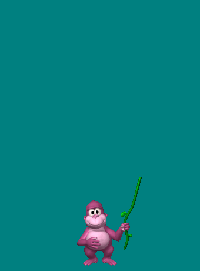

# BonziBuddy-rs

A safe, offline, cross-platform (Windows / macOS / Linux) reimplementation of the
1999 [BonziBuddy](https://en.wikipedia.org/wiki/BonziBuddy) desktop companion,
written in Rust, using the **original character art, animations, sounds and
joke/fact content** extracted from the archived installer.

The original was famous as spyware. This reimplementation contains
**zero network code** — no phone-home, no telemetry, no ads, no gating.



## What the original did (and what was removed)

Findings from reverse-engineering `BonziBuddy432.exe` (v4.32, from the
[Internet Archive](https://archive.org/details/BonziBUDDY_201812)); raw
evidence in `analysis/` (`bonzi_exe_urls.txt`, `installer.strings.txt`):

| Original behavior | Evidence | This project |
|---|---|---|
| Phone-home / IM beacon to `im.bonziworld.com` | strings + `MSWinsockLib.Winsock` ActiveX imports | **removed** — no sockets anywhere |
| Logged your browsing history (`Browse.nbd`) and search queries (`Search.nbd`) | on-disk spy logs, odd-byte+1 "encryption" | **never loaded** (see `src/content.rs`) |
| Ad links (`sites.nbd`) and daily content feed (`Daily.nbd`) fetched from bonzi.com | nbd payloads, updater strings | **never loaded** |
| Email modules for referral spam (`emsmtp.dll`, `empop3.dll`) | installer file list | **not reimplemented** |
| "Bonzi's Download Manager" — fetch & run remote payloads, IE hook | `Apps.nbd`, installer strings | **not reimplemented** |
| Paid upsell gating ("Bonzi Unlimited") | EULA/registration strings | **everything is free, forever** |
| Registry persistence / autostart | installer strings | **none** — single binary, no install |

`cargo tree` (247 crates) contains no HTTP/TLS/socket dependency; `src/`
contains no `TcpStream`/`UdpSocket`/`connect` call. The only network-adjacent
string in the tree is the crate `scoped-tls` (thread-local storage, not TLS).

## Where the assets come from

1. `analysis/BonziBuddy432.exe` — archived installer (Internet Archive).
2. CAB payloads (`payload.cab`, `data_fixed.cab`) unpacked with 7z.
3. `analysis/acs_extract.py` — parser for the MS Agent `.acs` character format:
   decodes the pose/animation database into 146 PNG sprite animations
   (`assets/bonzi/sprites/`), frame timings and return-animations
   (`animations.json`), plus the original WAV sounds.
4. `.nbd` content files ("encryption" = add 1 to every odd byte) decoded into
   `assets/content/nbd_decoded.json`: ~600 original jokes, facts and songs,
   with the original `<sp=...>` / `\pau=2000\` TTS markup stripped at load.

## Features

- **Idle behavior faithful to `tmrCharacterAction_Timer` +
  `RandomActionEvent`** (`analysis/BONZI432_RE.md` §2): a countdown re-arms
  to 5–10 ticks after each action and fires only while the *user* is idle
  (measured via the X11 MIT-SCREEN-SAVER extension on X11/XWayland; other
  platforms treat the user as idle). The draw is the original's
  `Int(8*Rnd+1)`: six cases land on silent random-idle playback, case 3 is
  the "Search" gag (Play Search + speak a fact), case 5 the "Explain" gag
  (Play Explain + speak a joke) — so Bonzi is weighted toward quiet idle
  animations, exactly like the original. The original's walking itself was
  performed by MS Agent (`agentsvrs.exe`), not the payload; the clone's
  walk is a reimplementation included among the idle draws.
- Original Bonzi sprite animations (idle, blink, walk, dance, hide, think,
  read, write, search, sunglasses…), driven by the original per-frame
  timings and return-animation graph — all 146 animations from the `.acs`.
- **Original voice clips**: the `.acs` stores Bonzi's actual voice samples
  (`bonzi/audio/audio_000..021.wav`) on specific animation frames — he now
  talks in the original voice mid-HUG, mid-GIGGLE, while idling, walking,
  hiding, exactly where the 1999 character did.
- Speech bubbles with the original joke/fact/song corpus, cleaned of the
  VocalTec markup (the parser treats `\` as a field delimiter — the original
  data has odd backslash counts, so pair-based parsing leaks `spd=`/`pit=`
  noise); optional local TTS (`--tts`: `say` on macOS, PowerShell
  System.Speech on Windows, espeak-ng on Linux).
- `[username]` placeholders in the original scripts are replaced with your
  name: `--name NAME` (or `BONZI_NAME`), else the login account name.
- Click to pet, right-click menu (joke / fact / **what time is it?** / song
  / trick / dance / walk / ask / settings / hide / about / quit). The clock
  trick reads the local clock — no network.
- **Ask Bonzi…** — optional chat with any OpenAI-compatible endpoint
  (`/chat/completions`). Off unless you configure it in **Settings…** (the
  forked window: endpoint / API key / model, Tab to switch fields, Enter to
  save); replies appear in the speech bubble and via TTS. With no endpoint
  set the binary never opens a socket.
- Chat replies own the voice: a pending gag is dropped, frame-carried sound
  effects stay silent, and the idle engine waits until the answer has been
  read and spoken (user menu clicks still interrupt — the user outranks the
  model). The model can also direct his body: the persona prompt teaches it
  to embed one `[anim:NAME]` stage direction per reply (WINK, HUG, DANCE-ish
  SUNGLASSESCONTINUED, WALK, HIDE, …); the marker is stripped before
  speaking and applied as a visual-only animation.
- System tray icon: left-click toggles visibility, menu has Show / Hide,
  **Reset Zoom** and Quit; the buddy menu's "Hide" minimizes to the tray.
  Reset Zoom restores 1.0× and pulls the window back onto the monitor —
  the escape hatch after zooming Bonzi out of sight. On Linux this needs
  `libappindicator` (e.g. `pacman -S libappindicator`); without a tray, Hide
  auto-returns after 8 s.
- Grab **the buddy himself** and drag: the window follows the pointer
  (manual `set_outer_position` — an override-redirect window is unmanaged,
  so `drag_window()` cannot work). A press without motion is a click and
  pets him instead. He walks along the bottom of the work area and turns
  at screen edges; walk speed is wall-clock (150 logical px/s at 1×,
  scaling with zoom and DPI) so the vine-swing feet never slide on ice
  at 120 Hz or after a frame hitch.
- **Settings…** opens a separate, normal (WM-managed) window — a forked
  child process (`--settings-ui`) with real text fields: click to place the
  caret, arrows/Home/End/Delete, Tab between fields, Enter/Save writes the
  config and the pet hot-reloads it via file mtime. The pet's own window
  can't host reliable text entry because the WM never focuses an
  override-redirect window. The surface is sized to the window's physical
  pixels, so it renders correctly under HiDPI/fractional scaling.
- **Ask Bonzi…** opens the same kind of forked child window (`--ask-ui`):
  type your question, Enter writes it to a handoff file the pet picks up
  via mtime and sends to your configured endpoint; Esc closes.
- Original WAV sound effects (`CHORD.WAV`, `Snd1/2.wav`, `Intro2.wav`) plus
  the 22 original voice samples, each wired to the animation frame that
  triggered it in the original `.acs` (mail checks, banana misses, reading
  grunts…). One voice at a time: every new action cuts off whatever was
  playing before it, and a test asserts no voice sample is left unreachable.
  **Dance!** choreographs a routine from original moves — jumps and
  crouches (whistle on every beat), giggles, bounces, waves — over the
  intro jingle. No dedicated dance animation exists in any free Bonzi
  payload (verified across the 4.3.2 cab, the MSAgent `.acs`, and the
  surfing variant: the "dance to MIDI" was paid Bonzi Unlimited content
  that never shipped), so the routine is sequenced from the real moves.
- `--test-audio` plays every bundled sound once, in sequence, and reports
  which output path (cpal device or `paplay`/`aplay`/`afplay`/`ffplay`)
  handled each one — the quickest way to confirm sound works on a new box.
- Scroll-wheel over the buddy resizes it (0.5×–4×); zoom **and window
  position** persist across restarts (`$XDG_CONFIG_HOME/bonzibuddy-rs.json`);
  `--scale N` sets it at launch and HiDPI scale factors are honored automatically.
- Zero registry writes, zero install steps. The only network path is the
  opt-in "Ask Bonzi" endpoint; with it unset nothing dials out.

## Transparency & window behavior

Frames are presented through `pixels`/wgpu on a 32-bit ARGB surface with
premultiplied alpha (verified: transparent pixels carry A=0 in the live window
buffer). A compositor is required for the see-through effect; without one use
`--matte`.

| Platform | Transparency | Always-on-top | Drag / walk |
|---|---|---|---|
| Windows | ✓ | ✓ | ✓ |
| macOS | ✓ | ✓ | ✓ |
| X11 (+compositor: KWin/compton/picom) | ✓ | ✓ | ✓ |
| Wayland (KWin, GNOME, …) | ✓ | ✓ via XWayland (default) | ✓ via XWayland (default) |

On a Wayland session the app automatically restarts its event loop over
**XWayland** (by unsetting `WAYLAND_DISPLAY` before winit initializes).
Native Wayland gives ordinary clients neither always-on-top nor
client-initiated window moves — Bonzi would sit frozen in one spot and sink
under other windows. Over XWayland he is an override-redirect window: no
taskbar entry, always above, and free to walk the length of the work area.
KWin and GNOME both composite XWayland windows, so transparency keeps
working. Set `BONZI_WAYLAND=1` to opt out and use native Wayland instead
(expect: no walking, and a KWin window rule "Keep Above" for stacking).

## Audio

Sound effects play through cpal with the **JACK backend enabled** in addition
to ALSA: if you run jackd (or PipeWire's jack bridge) Bonzi connects to it
directly. If the default device is busy or misconfigured, every enumerated
device is tried; if none opens, playback falls back to `paplay`/`aplay`/
`afplay`/`ffplay`, and finally to silence. ALSA/JACK print connection-probe
failures to stderr even when another backend works, so the probe phase runs
with stderr silenced on Unix.

No sound? Run with `BONZI_AUDIO_DEBUG=1` — every host and device probe is
printed (`[audio] host Alsa default …: <error>`), and the fallback chain
tells you which player it used. On PipeWire desktops the ALSA default is
usually fine; a "no audio device" note with no `[audio]` lines means the
`audio` feature was compiled out.

## Building & running

```sh
cargo run --release
```

Flags:

| Flag | Effect |
|---|---|
| `--scale N` | sprite/UI scale multiplier (0.5–4.0) |
| `--name NAME` | name used for `[username]` in the scripts (or `BONZI_NAME`) |
| `--matte` | solid Win95-teal backdrop instead of transparency (for WMs without a compositor) |
| `--no-audio` | start silent |
| `--tts` | speak bubbles with the OS voice |
| `--assets PATH` | asset directory (default search: `$BONZI_ASSETS`, `./assets`, `../assets`, next to the binary, `/usr/share/bonzibuddy-rs/assets`) |

Linux tray icon requires `libappindicator` at runtime
(e.g. `sudo pacman -S libappindicator`); everything else runs without it.

### Cross-compiling / CI

```sh
cargo check --target x86_64-pc-windows-msvc          # passes from Linux
cargo check --target aarch64-apple-darwin --no-default-features
```

`coreaudio-sys` (via rodio→cpal) needs the macOS SDK at build time, so full
audio builds for macOS must happen on macOS. The `audio` feature (default on)
can be disabled (`--no-default-features`) for headless or SDK-less builds.
Linux transparency needs a compositor; without one use `--matte`. wgpu uses
Vulkan/Metal/D3D12 with an OpenGL (`gles`) fallback for ancient or
virtualized drivers.

## Tests

```sh
cargo test        # content-pool + TTS-markup-stripping regression tests
```

## Layout

```
src/main.rs      event loop, window, input, menu, walk physics
src/pet.rs       state machine: Action queue → animation/bubble/effects
src/assets.rs    .acs-derived sprite/anim/audio loading + caches
src/content.rs   .nbd joke corpus + TTS markup stripper
src/render.rs    CPU canvas: alpha blend, rounded rects, text wrap (ab_glyph)
src/tts.rs       OS voice subprocess (only process spawned; local only)
analysis/        RE tooling + raw evidence (kept for auditability)
assets/          extracted original assets (see below)
```

## License & asset provenance

Code is MIT. The BonziBuddy character, art, sounds and text are © BONZI.COM
Software / CNET Industries and are used here strictly as an abandonware
preservation artifact, extracted from a publicly archived installer; they are
not licensed for redistribution by this project. Download and run at your own
discretion.

## Roadmap

- Menu +/- size items alongside scroll-wheel resize.
- Optional local-LLM "brain": an OpenAPI-compatible client that pushes the
  same `pet::Action` values the offline engine already speaks (`src/pet.rs`).
